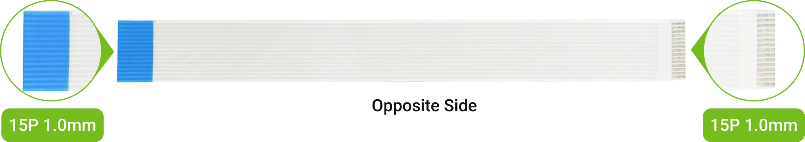
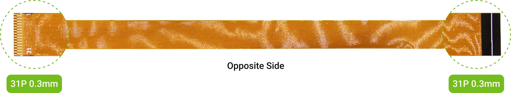

# RK628 kernel driver for Raspberry Pi4/5

**English** | [简体中文](README.zh-CN.md)

[](https://www.debian.org/)
[](#tested-environments)

This project provides a Raspberry Pi 4/5 driver for the `Radxa 4K HDMI IN to MIPI CSI-2 Adapter`, with support for audio and video capture.

## Tested environments

| Platform | OS | Architecture | Kernel |
| --- | --- | --- | --- |
| Raspberry Pi 4 | Debian GNU/Linux 13.7 (trixie) | `aarch64` | `6.18.60+rpt-rpi-v8` |
| Raspberry Pi 5 | Debian GNU/Linux 13.7 (trixie) | `aarch64` | `6.18.50+rpt-rpi-2712` |

## Specifications

- The adapter provides both 2-lane and 4-lane MIPI CSI-2 interfaces. Currently, only the 4-lane interface is supported on Pi 5, and only the 2-lane interface is supported on Pi 4.

- Video input: HDMI input supports up to 4K (3840×2160) at 30 fps.

- Video output: the 4-lane interface supports up to 4K (3840×2160) at 30 fps on Pi 5; the 2-lane interface supports up to 2K (2560×1440) at 30 fps on Pi 4.

## Hardware connections

### Parts list

#### Common parts

| Part | Quantity |
| --- | :---: |
| Radxa 4K HDMI IN to MIPI CSI-2 Adapter | 1 |
| Raspberry Pi 4 or Raspberry Pi 5 | 1 |
| Female-to-female jumper wires | 6 |

#### Pi 4 parts

| AC014 opposite-side FPC cable × 1 |
| :---: |
|  |
| 15P 1.0 mm to 15P 1.0 mm |

#### Pi 5 parts

| AC006 opposite-side FPC cable × 1 | 22P-to-22P ribbon cable × 1 | 22P-to-31P adapter × 1 |
| :---: | :---: | :---: |
|  |  |  |
| 31P 0.3 mm to 31P 0.3 mm | 22P to 22P | 22P to 31P |

### HDMI

Connect an HDMI source. Input up to 4K (3840×2160) at 30 fps is supported.

### MIPI CSI

For Pi 4, use a `15pin to 15pin` ribbon cable to connect the adapter's 2-lane MIPI CSI interface to the Pi 4's `CAMERA` connector.

For Pi 5, use a `31pin to 31pin` ribbon cable to connect the adapter's 4-lane MIPI CSI interface to the 31-pin connector on the `22P-to-31P adapter`. Then use a `22P-to-22P` ribbon cable to connect the adapter's 22-pin connector to the Pi 5's `CAM/DISP0` or `CAM/DISP1` connector.

### I2S

| Adapter 7-pin header | Pi 4/5 connection |
| :---: | :---: |
| I2S D0 | GPIO20, physical pin **38** |
| I2S LRCK | GPIO19, physical pin **35** |
| I2S SCLK | GPIO18, physical pin **12** |
| GND | Any GND pin on the Raspberry Pi |

### DET, INT

| Adapter 7-pin header | Pi 4/5 connection |
| :---: | :---: |
| DET | GPIO25, physical pin **22** |
| INT | GPIO17, physical pin **11** |

## Installation and configuration

These instructions apply to **64-bit Raspberry Pi OS**.

### Driver installation

Choose either installation method, then configure the device tree overlay and reboot.

#### From a .deb

Download the `rk628-rpi-dkms` package from the [latest Release](https://github.com/NujoulDev/rk628-rpi-driver/releases/latest).

In the download directory, replace `PACKAGE.deb` with the downloaded filename and run these commands.

```bash
sudo apt update
sudo apt install ./PACKAGE.deb
```

#### From source

Install the build tools and headers for the running kernel.

```bash
sudo apt update
sudo apt install -y \
  git ca-certificates \
  build-essential dkms device-tree-compiler \
  "linux-headers-$(uname -r)"
```

Check the running kernel version and confirm that the matching headers are available.

```bash
uname -r
ls "/lib/modules/$(uname -r)/build/Makefile"
```

Clone the repository and run the installer.

```bash
git clone https://github.com/NujoulDev/rk628-rpi-driver.git
cd rk628-rpi-driver
sudo ./scripts/install.sh
```

The installer prints `Done.` when installation is complete.

### Overlay configuration

Open `/boot/firmware/config.txt`.
Change the default `camera_auto_detect=1` to:
```txt
camera_auto_detect=0
```

Edit the `[all]` section at the end of the file:

Pi 4 uses `rk628-pi4`, with a fixed 2-lane configuration:

| Optional parameter | Default | Description |
| --- | --- | --- |
| `audio` | Disabled | Enable HDMI audio output over I2S and the `RK628HDMI` ALSA capture device. I2S wiring is required. |


Pi 5 uses `rk628-pi5`, with a fixed 4-lane configuration:

| Optional parameter | Default | Description |
| --- | --- | --- |
| `audio` | Disabled | Enable HDMI audio output over I2S and the `RK628HDMI` ALSA capture device. I2S wiring is required. |
| `cam0` | Selected | Use CAM/DISP0 and select its corresponding I2C, CSI, and power controls. |
| `cam1` | Not selected | Use CAM/DISP1 and select its corresponding I2C, CSI, and power controls. |

Choose either `cam0` or `cam1`. If neither is specified, CAM/DISP0 is used.

Configuration examples (keep only the line matching your platform and wiring):

```txt
# Pi 4: video and audio
dtoverlay=rk628-pi4,audio

# Pi 5 CAM/DISP0: video and audio
dtoverlay=rk628-pi5,audio

# Pi 5 CAM/DISP1: video and audio
dtoverlay=rk628-pi5,cam1,audio
```

For video capture only, remove `,audio`.

Reboot:

```bash
sudo reboot
```

### Video capture configuration

After rebooting, udev creates device aliases for RK628, so the following commands do not need to be changed when device numbers change:

| Device path | Purpose |
| --- | --- |
| `/dev/rk628-video` | Video capture node |
| `/dev/rk628-media` | Media device for viewing and configuring the capture pipeline |
| `/dev/rk628-subdev` | RK628 subdevice, used to query HDMI input timings on Pi 5 |

View the corresponding symbolic links:

```bash
ls -l /dev/rk628-*
```

Choose one of the following methods to configure video capture.

#### Automatic configuration with media-initd

Follow the [rk628-media-initd installation instructions](https://github.com/NujoulDev/rk628-media-initd#readme). The service waits for a stable HDMI signal and configures capture once each time it starts.

After switching HDMI sources, changing the input resolution, or reconnecting HDMI, stop any running capture application and restart the service.

```bash
sudo systemctl restart rk628-media-initd.service
```

#### Manual configuration

Install the configuration tools with `sudo apt install v4l-utils`. Query the HDMI input timings and set the video format to match the input resolution. On Pi 5, also configure the capture pipeline.

Example commands for Pi 4:

```bash
# Query HDMI input timings
v4l2-ctl -d /dev/rk628-video --query-dv-timings
# Set the video resolution to match the HDMI input timings
v4l2-ctl -d /dev/rk628-video \
  --set-fmt-video=width=1920,height=1080,pixelformat=UYVY,field=none
```

Example commands for Pi 5 (the example uses `csi2` input pad `0` and output pad `4`, which connects to `rp1-cfe-csi2_ch0`; use the actual pad numbers if your topology differs):

```bash
# View the capture pipeline
media-ctl -d /dev/rk628-media -p
# Query HDMI input timings
v4l2-ctl -d /dev/rk628-subdev --query-dv-timings
# Set the video resolution to match the HDMI input timings
media-ctl -d /dev/rk628-media \
  -l '"csi2":4 -> "rp1-cfe-csi2_ch0":0 [1]'

media-ctl -d /dev/rk628-media \
  -V '"csi2":0 [fmt:UYVY8_1X16/1920x1080 field:none]'

media-ctl -d /dev/rk628-media \
  -V '"csi2":4 [fmt:UYVY8_1X16/1920x1080 field:none]'

v4l2-ctl -d /dev/rk628-video \
  --set-fmt-video=width=1920,height=1080,pixelformat=UYVY
```

## Verification

### Install verification dependencies

```bash
sudo apt install -y \
  v4l-utils alsa-utils \
  gstreamer1.0-tools gstreamer1.0-plugins-base \
  gstreamer1.0-plugins-good gstreamer1.0-gl gstreamer1.0-alsa
```

### media-initd

If you installed media-initd, check the service status and the logs for the current boot.

```bash
systemctl status rk628-media-initd.service
sudo journalctl -u rk628-media-initd.service -b
```

A `Ready:` message indicates that capture is configured. For a 1080p input, it looks like this.

```text
Ready: /dev/rk628-video 1920x1080 UYVY
```

### Driver loading

Video driver:

```bash
sudo dmesg | grep -i rk628
```

When the driver is loaded correctly, the output should look similar to this:

```bash
RK628 I2C driver version: 00.01.00
rk628 version is: RK628F/H (20230321)
rk628-csi-v4l2 found @ 0xa0 (rk3x-i2c)
rk628_csi_format_change: New format: 1920x1080p60.00 (2200x1125)
```

Audio driver:

```bash
arecord -l
```

When the driver is loaded correctly, the output should look similar to this:

```bash
**** List of CAPTURE Hardware Devices ****
card 3: RK628HDMI [RK628HDMI], device 0: bcm2835-i2s-dir-hifi dir-hifi-0 [bcm2835-i2s-dir-hifi dir-hifi-0]
  Subdevices: 1/1
  Subdevice #0: subdevice #0
```

### Video capture and playback

Capture 300 frames to `/dev/null` and check the frame rate and dropped-buffer messages.

```bash
v4l2-ctl -d /dev/rk628-video --get-fmt-video
v4l2-ctl -d /dev/rk628-video \
  --stream-mmap=4 --stream-count=300 --stream-to=/dev/null
echo $?
```

On successful completion, the exit code is 0 and 300 frames have been captured. The reported frame rate should be close to the HDMI input frame rate, with no `VIDIOC_STREAMON` errors or persistent `dropped buffers` messages. Press `Ctrl+C` to stop early.

> [!NOTE]
> Both GStreamer video playback commands below assume a 1920×1080 HDMI input at 60 fps. Query the actual input timings first, then set `width`, `height`, and `framerate` accordingly:
>
> - Pi 4: `v4l2-ctl -d /dev/rk628-video --query-dv-timings`
> - Pi 5: `v4l2-ctl -d /dev/rk628-subdev --query-dv-timings`
>
> `Active width` and `Active height` correspond to `width` and `height`; 60 fps corresponds to `framerate=60/1`. These timings describe the HDMI input received by RK628, independently of the Raspberry Pi desktop display resolution.

Play live video on the display:

```bash
gst-launch-1.0 -e \
  v4l2src device=/dev/rk628-video io-mode=dmabuf do-timestamp=true ! \
    video/x-raw,format=UYVY,width=1920,height=1080,framerate=60/1 ! \
    queue max-size-buffers=2 max-size-bytes=0 max-size-time=0 leaky=downstream ! \
    glimagesink sync=true
```

An HDMI preview should appear on the desktop. Press Ctrl+C to stop.

### Audio capture and playback

> [!NOTE]
> The recording and combined audio/video playback commands below assume a 48000 Hz HDMI audio input. On both Pi 4 and Pi 5, use the following command to query the actual sample rate and audio status:
>
> ```bash
> v4l2-ctl -d /dev/rk628-subdev \
>   --get-ctrl=audio_sampling_rate,audio_present
> ```
>
> When `audio_sampling_rate` is `48000`, use `-r 48000` with `arecord` and `rate=48000` with GStreamer. If it is `44100`, change both values to `44100`. An `audio_present` value of `1` means audio is detected. If it is `0`, confirm that the source is sending audio over HDMI, wait for the signal to stabilize, and query again.

Record:

```bash
arecord -D hw:CARD=RK628HDMI,DEV=0 \
  -t wav -f S32_LE -r 48000 -c 2 -d 10 rk628-audio.wav

echo $?
```

The exit code is 0 on successful completion.

Play the recording:

```
gst-launch-1.0 -e \
  filesrc location=rk628-audio.wav ! wavparse ! \
  audioconvert ! audioresample ! pulsesink
```

### Simultaneous audio and video playback

Select the audio output device in the desktop volume menu before playback.

```
gst-launch-1.0 -e \
  v4l2src device=/dev/rk628-video io-mode=dmabuf do-timestamp=true ! \
    video/x-raw,format=UYVY,width=1920,height=1080,framerate=60/1 ! \
    queue max-size-buffers=2 max-size-bytes=0 max-size-time=0 leaky=downstream ! \
    glimagesink sync=true \
  alsasrc device="hw:CARD=RK628HDMI,DEV=0" \
    buffer-time=40000 latency-time=5000 ! \
    audio/x-raw,format=S32LE,rate=48000,channels=2 ! \
    queue ! audioconvert ! audioresample ! \
    pulsesink buffer-time=40000 latency-time=5000 sync=true
```

An HDMI preview should appear on the desktop, and HDMI audio should play through the default system audio output. Press Ctrl+C to stop.

## Upgrade

- **Installed from a .deb**. Download the new package from the [latest Release](https://github.com/NujoulDev/rk628-rpi-driver/releases/latest) and [install it with APT](#from-a-deb).
- **Installed from source**. Run `sudo ./scripts/install.sh` from the updated source directory.

Reboot to load the updated modules and overlay. To upgrade [media-initd](https://github.com/NujoulDev/rk628-media-initd), download and install its new `.deb` separately.

## Uninstall

If you installed media-initd, remove it first.

```bash
sudo apt purge rk628-media-initd
```

If you installed the driver from a `.deb`, remove it with APT.

```bash
sudo apt purge rk628-rpi-dkms
```

If you installed the driver from source, run the uninstaller from the source directory.

```bash
sudo ./scripts/uninstall.sh
```

Undo the changes to `/boot/firmware/config.txt`:

```txt
sudo vi /boot/firmware/config.txt
```

Remove the `dtoverlay=rk628-pi4` or `dtoverlay=rk628-pi5` line added during installation, including any parameters, and restore `camera_auto_detect` to its previous setting.

Reboot:

```bash
sudo reboot
```
