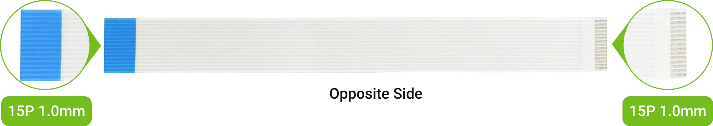
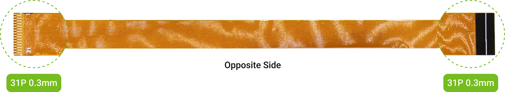

# RK628 kernel driver for Raspberry Pi4/5

[English](README.md) | **简体中文**

[](https://www.debian.org/)
[](#已测试环境)

该项目为 `瑞莎 4K HDMI IN 转 MIPI CSI-2 转接板` 在 Raspberry Pi4/5 上的驱动程序，支持音频、视频采集。

## 已测试环境

| 平台 | 系统 | 架构 | 内核 |
| --- | --- | --- | --- |
| Raspberry Pi 4 | Debian GNU/Linux 13.7 (trixie) | `aarch64` | `6.18.60+rpt-rpi-v8` |
| Raspberry Pi 5 | Debian GNU/Linux 13.7 (trixie) | `aarch64` | `6.18.50+rpt-rpi-2712` |

## 关键参数
- 转接板提供 2-lane 和 4-lane 两种 MIPI CSI-2 接口，目前在 Pi5上仅支持 4-lane 接口，Pi4 上仅支持 2-lane 接口。

- 视频输入：HDMI输入最高支持 4K（3840×2160）30fps。

- 视频输出：4-lane 接口在 Pi5 上的最大分辨率为 4K（3840×2160）30fps，2-lane 接口在 Pi4 上的最大分辨率为 2K（2560×1440）30fps。

## 硬件连接

### 配件清单

#### 通用配件

| 配件 | 数量 |
| --- | :---: |
| 瑞莎 4K HDMI IN 转 MIPI CSI-2 转接板 | 1 |
| Raspberry Pi 4 或 Raspberry Pi 5 | 1 |
| 母对母杜邦线 | 6 根 |

#### Pi4 配件

| AC014 异面 FPC 排线 × 1 |
| :---: |
|  |
| 15P 1.0 mm 转 15P 1.0 mm |

#### Pi5 配件

| AC006 异面 FPC 排线 × 1 | 22P 转 22P 排线 × 1 | 22P-to-31P 转接板 × 1 |
| :---: | :---: | :---: |
|  |  |  |
| 31P 0.3 mm 转 31P 0.3 mm | 22P 转 22P | 22P 转 31P |

### HDMI

接入 HDMI 信号源，支持 4K（3840×2160）30fps。

### MIPI CSI

使用 Pi4 时，使用 `15pin to 15pin` 排线将转接板的 MIPI CSI 2lane 接口连接到 Pi4 的 `CAMERA` 接口上。

使用 Pi5 时，使用 `31pin to 31pin` 排线将转接板的 MIPI CSI 4lane 接口连接 `22P-to-31P 转接板` 的31Pin接口 ，再使用 `22P-to-22P` 将 `22P-to-31P 转接板` 的22Pin接口连接到 Pi5 的 `CAM/DISP0` 或 `CAM/DISP1` 接口上。

### I2S

| 转接板7pin排针 | Pi 4/5 接点 |
| :---: | :---: |
| I2S D0 | GPIO20，物理脚 **38** |
| I2S LRCK | GPIO19，物理脚 **35** |
| I2S SCLK | GPIO18，物理脚 **12** |
| GND | 树莓派上任意GND引脚 |

### DET、INT

|  转接板7pin排针 | Pi 4/5 接点 |
| :---: | :---: |
| DET | GPIO25，物理脚 **22** |
| INT | GPIO17，物理脚 **11** |

## 安装与配置

以下步骤适用于 **64 位 Raspberry Pi OS**。驱动安装后，再配置设备树 overlay。

### 驱动安装

选择下面任意一种方式。安装后，继续配置 overlay 并重启。

#### 从 .deb 安装

从 [最新 Release](https://github.com/NujoulDev/rk628-rpi-driver/releases/latest) 下载 `rk628-rpi-dkms` 的 `.deb`。

在下载目录执行以下命令，把 `PACKAGE.deb` 换成实际文件名。

```bash
sudo apt update
sudo apt install ./PACKAGE.deb
```

#### 从源码安装

先安装编译工具和当前内核的头文件。

```bash
sudo apt update
sudo apt install -y \
  git ca-certificates \
  build-essential dkms device-tree-compiler \
  "linux-headers-$(uname -r)"
```

检查当前内核版本和头文件是否匹配。

```bash
uname -r
ls "/lib/modules/$(uname -r)/build/Makefile"
```

下载源码并运行安装脚本。

```bash
git clone https://github.com/NujoulDev/rk628-rpi-driver.git
cd rk628-rpi-driver
sudo ./scripts/install.sh
```

看到 `Done.` 表示脚本已完成安装。

### overlay 配置

打开 `/boot/firmware/config.txt` 文件
将默认的 `camera_auto_detect=1` 改为：
```txt
camera_auto_detect=0
```

修改文件末尾的 `[all]` 节点：

Pi 4 使用 `rk628-pi4`，固定 2-lane：

| 可选参数 | 默认状态 | 说明 |
| --- | --- | --- |
| `audio` | 关闭 | 启用 HDMI 音频的 I2S 输出和 ALSA 采集声卡 `RK628HDMI`，需连接 I2S 信号线。 |


Pi 5 使用 `rk628-pi5`，固定 4-lane：

| 可选参数 | 默认状态 | 说明 |
| --- | --- | --- |
| `audio` | 关闭 | 启用 HDMI 音频的 I2S 输出和 ALSA 采集声卡 `RK628HDMI`，需连接 I2S 信号线。 |
| `cam0` | 默认选择 | 使用 CAM/DISP0，同时选择对应的 I2C、CSI 和供电控制。 |
| `cam1` | 未选择 | 使用 CAM/DISP1，同时选择对应的 I2C、CSI 和供电控制。 |

`cam0`、`cam1` 二选一，省略时使用 CAM/DISP0。

配置示例（只保留与平台和接线对应的一行）：

```txt
# Pi 4：视频和音频
dtoverlay=rk628-pi4,audio

# Pi 5 CAM/DISP0：视频和音频
dtoverlay=rk628-pi5,audio

# Pi 5 CAM/DISP1：视频和音频
dtoverlay=rk628-pi5,cam1,audio
```

仅采集视频时去掉 `,audio`。

重启

```bash
sudo reboot
```

### 视频采集配置

重启后，udev 为 RK628 创建设备别名，后续命令无需根据设备编号修改：

| 设备路径 | 用途 |
| --- | --- |
| `/dev/rk628-video` | 视频采集节点 |
| `/dev/rk628-media` | media 设备，用于查看和配置采集链路 |
| `/dev/rk628-subdev` | RK628 子设备，Pi5 用于查询 HDMI 输入时序 |

查看对应软链接

```bash
ls -l /dev/rk628-*
```

视频采集前，选择下面任意一种方式配置。

#### 使用 media-initd 自动配置

按 [rk628-media-initd 的安装说明](https://github.com/NujoulDev/rk628-media-initd#readme) 安装服务。它会在启动后等待 HDMI 信号稳定，然后自动配置一次采集设备。

更换 HDMI 输入源、修改分辨率或重新插拔 HDMI 后，先停止正在运行的采集程序，再重启服务。

```bash
sudo systemctl restart rk628-media-initd.service
```

#### 手动配置

先用 `sudo apt install v4l-utils` 安装配置工具。查询 HDMI 输入时序，再按实际分辨率设置视频格式。Pi 5 还需要配置采集链路。

Pi4 上的参考命令：

```bash
# 查询 HDMI 输入时序
v4l2-ctl -d /dev/rk628-video --query-dv-timings
# 根据 HDMI 输入时序设置视频分辨率
v4l2-ctl -d /dev/rk628-video \
  --set-fmt-video=width=1920,height=1080,pixelformat=UYVY,field=none
```

Pi5 上的参考命令（示例中的 `csi2` 输入 pad 为 `0`，连接 `rp1-cfe-csi2_ch0` 的输出 pad 为 `4`；若拓扑中的编号不同，使用实际编号）：

```bash
# 查看采集链路
media-ctl -d /dev/rk628-media -p
# 查询 HDMI 输入时序
v4l2-ctl -d /dev/rk628-subdev --query-dv-timings
# 根据 HDMI 输入时序设置视频分辨率
media-ctl -d /dev/rk628-media \
  -l '"csi2":4 -> "rp1-cfe-csi2_ch0":0 [1]'

media-ctl -d /dev/rk628-media \
  -V '"csi2":0 [fmt:UYVY8_1X16/1920x1080 field:none]'

media-ctl -d /dev/rk628-media \
  -V '"csi2":4 [fmt:UYVY8_1X16/1920x1080 field:none]'

v4l2-ctl -d /dev/rk628-video \
  --set-fmt-video=width=1920,height=1080,pixelformat=UYVY
```

## 验证

### 安装验证依赖

```bash
sudo apt install -y \
  v4l-utils alsa-utils \
  gstreamer1.0-tools gstreamer1.0-plugins-base \
  gstreamer1.0-plugins-good gstreamer1.0-gl gstreamer1.0-alsa
```

### media-initd

安装了 media-initd 的用户，可以用以下命令查看服务状态和本次开机日志。

```bash
systemctl status rk628-media-initd.service
sudo journalctl -u rk628-media-initd.service -b
```

日志出现 `Ready:` 表示采集配置完成。下面是 1080p 输入的日志示例。

```text
Ready: /dev/rk628-video 1920x1080 UYVY
```

### 驱动加载

视频驱动：

```bash
sudo dmesg | grep -i rk628
```

正确加载驱动会有以下类似输出：

```bash
RK628 I2C driver version: 00.01.00
rk628 version is: RK628F/H (20230321)
rk628-csi-v4l2 found @ 0xa0 (rk3x-i2c)
rk628_csi_format_change: New format: 1920x1080p60.00 (2200x1125)
```

音频驱动：

```bash
arecord -l
```

正确加载驱动会有以下类似输出：

```bash
**** List of CAPTURE Hardware Devices ****
card 3: RK628HDMI [RK628HDMI], device 0: bcm2835-i2s-dir-hifi dir-hifi-0 [bcm2835-i2s-dir-hifi dir-hifi-0]
  Subdevices: 1/1
  Subdevice #0: subdevice #0
```

### 视频采集与播放

实际采集 300 帧到 `/dev/null`，查看帧率和丢帧提示。

```bash
v4l2-ctl -d /dev/rk628-video --get-fmt-video
v4l2-ctl -d /dev/rk628-video \
  --stream-mmap=4 --stream-count=300 --stream-to=/dev/null
echo $?
```

正常完成时退出码为 0，完成 300 帧采集，打印的帧率接近 HDMI 输入帧率，且没有 `VIDIOC_STREAMON` 错误或持续的 `dropped buffers` 提示。需要提前停止时按 `Ctrl+C`。

> [!NOTE]
> 下方两处 GStreamer 视频播放命令以 1920×1080、60 fps 的 HDMI 输入为例。请先查询实际输入时序，并将命令中的 `width`、`height` 和 `framerate` 改为对应值：
>
> - Pi4：`v4l2-ctl -d /dev/rk628-video --query-dv-timings`
> - Pi5：`v4l2-ctl -d /dev/rk628-subdev --query-dv-timings`
>
> `Active width` 和 `Active height` 分别对应 `width` 和 `height`；60 fps 对应 `framerate=60/1`。这里查询的是 RK628 接收的 HDMI 输入，与树莓派桌面显示器的分辨率无关。

实时播放视频到屏幕：

```bash
gst-launch-1.0 -e \
  v4l2src device=/dev/rk628-video io-mode=dmabuf do-timestamp=true ! \
    video/x-raw,format=UYVY,width=1920,height=1080,framerate=60/1 ! \
    queue max-size-buffers=2 max-size-bytes=0 max-size-time=0 leaky=downstream ! \
    glimagesink sync=true
```

正常情况下桌面会出现 HDMI 预览画面，按 Ctrl+C 停止运行。

### 音频采集与播放

> [!NOTE]
> 录音和下方同时播放音视频的命令均以 48000 Hz 的 HDMI 音频输入为例。Pi4、Pi5 都可以使用以下命令查询实际采样率和音频状态：
>
> ```bash
> v4l2-ctl -d /dev/rk628-subdev \
>   --get-ctrl=audio_sampling_rate,audio_present
> ```
>
> `audio_sampling_rate` 为 `48000` 时，`arecord` 使用 `-r 48000`，GStreamer 使用 `rate=48000`；如果为 `44100`，两处均改为 `44100`。`audio_present` 为 `1` 表示检测到音频；如果为 `0`，请确认输入源正在通过 HDMI 输出声音，等待信号稳定后重新查询。

采集：

```bash
arecord -D hw:CARD=RK628HDMI,DEV=0 \
  -t wav -f S32_LE -r 48000 -c 2 -d 10 rk628-audio.wav

echo $?
```

正常完成时退出码为 0

播放：

```
gst-launch-1.0 -e \
  filesrc location=rk628-audio.wav ! wavparse ! \
  audioconvert ! audioresample ! pulsesink
```

### 同时播放音频和视频

请提前在桌面音量菜单中选择音频播放设备

```
gst-launch-1.0 -e \
  v4l2src device=/dev/rk628-video io-mode=dmabuf do-timestamp=true ! \
    video/x-raw,format=UYVY,width=1920,height=1080,framerate=60/1 ! \
    queue max-size-buffers=2 max-size-bytes=0 max-size-time=0 leaky=downstream ! \
    glimagesink sync=true \
  alsasrc device="hw:CARD=RK628HDMI,DEV=0" \
    buffer-time=40000 latency-time=5000 ! \
    audio/x-raw,format=S32LE,rate=48000,channels=2 ! \
    queue ! audioconvert ! audioresample ! \
    pulsesink buffer-time=40000 latency-time=5000 sync=true
```

正常情况下，桌面会显示 HDMI 预览画面，系统默认音频输出设备会播放 HDMI 声音。按 Ctrl+C 停止。

## 升级

- **通过 .deb 安装**的用户，从 [最新 Release](https://github.com/NujoulDev/rk628-rpi-driver/releases/latest) 下载新版，按[安装步骤](#从-deb-安装)用 APT 安装。
- **通过源码安装**的用户，在新版源码目录运行 `sudo ./scripts/install.sh`。

升级驱动后重启，让新模块和 overlay 生效。如果需要升级 [media-initd](https://github.com/NujoulDev/rk628-media-initd)，另外下载它的新版 `.deb` 并用 APT 安装。

## 卸载

如果安装了 media-initd，先卸载它。

```bash
sudo apt purge rk628-media-initd
```

通过 `.deb` 安装驱动的用户，用 APT 卸载。

```bash
sudo apt purge rk628-rpi-dkms
```

通过源码安装驱动的用户，在源码目录运行卸载脚本。

```bash
sudo ./scripts/uninstall.sh
```

删除对 `/boot/firmware/config.txt` 的修改

```txt
sudo vi /boot/firmware/config.txt
```

删除本次添加的 `dtoverlay=rk628-pi4` 或 `dtoverlay=rk628-pi5` 配置行（包括附带的参数），将 `camera_auto_detect` 恢复为安装前的设置。

重启

```bash
sudo reboot
```
